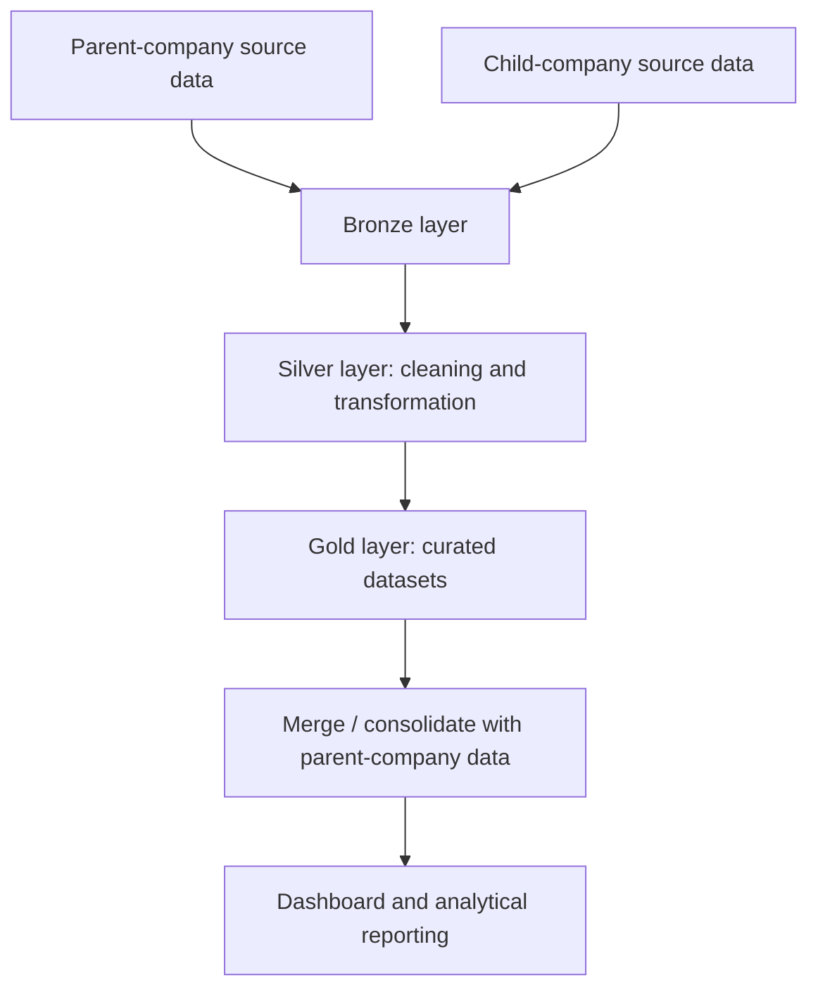

# 🛒 FMCG Data Engineering Pipeline with Databricks

An individual data engineering project that processes FMCG data from parent- and child-company sources using **Databricks, PySpark, Spark SQL, and Delta Lake**. The pipeline organizes data into Bronze, Silver, and Gold layers and includes both full-load and incremental-load workflows.

## 🎯 Project Overview

The project demonstrates a structured approach to ingesting, cleaning, transforming, standardizing, and consolidating FMCG customer, product, pricing, and order data. Child-company data is processed through layered tables and merged into parent-company datasets for downstream analysis.

## 🏗️ Architecture



### Medallion layers

- 🥉 **Bronze:** Ingests source CSV data into Delta tables and captures ingestion metadata where implemented.
- 🥈 **Silver:** Cleans and standardizes data, including handling duplicates, formatting inconsistencies, missing values, and selected data-quality issues.
- 🥇 **Gold:** Selects and shapes curated customer, product, pricing, and order datasets for downstream use.

## ⚙️ Technology Stack

- **Platform:** Databricks
- **Languages:** Python, Spark SQL
- **Processing:** PySpark
- **Storage/table format:** Delta Lake
- **Data patterns:** Bronze–Silver–Gold medallion architecture, full loading, incremental loading, Delta `MERGE` operations
- **Reporting artifact:** FMCG dashboard PDF

## 🔄 Pipeline Workflows

1. **Setup:** Configure the project catalog and schemas and create a date dimension table.
2. **Dimension processing:** Process customer, product, and gross-price data through Bronze, Silver, and Gold layers.
3. **Fact processing — full load:** Ingest order data, transform and join it with related dimensions, and consolidate the resulting data.
4. **Fact processing — incremental load:** Process newly arrived order data, identify affected months, recalculate the relevant monthly results, and merge updates into the parent-company Gold table.
5. **Reporting:** Use the curated data for the included dashboard/reporting artifact.

## 📁 Repository Structure

```text
.
├── 0_data/
│   ├── 1_parent_company/
│   │   ├── full_load/
│   │   └── incremental_load/
│   └── 2_child_company/
│       ├── full_load/
│       └── incremental_load/
├── 1_codes/
│   ├── 1_setup/
│   ├── 2_dimension_data_processing/
│   └── 3_fact_data_processing/
├── 2_dashboarding/
│   ├── denormalise_table_query_fmcg.txt
│   └── fmcg_dashboard.pdf
└── resources/
    ├── databricks_project.excalidraw
    └── project_architecture.png
```

## ▶️ Working with the Notebooks

The notebooks are intended to be run in a Databricks environment with access to the project data and the required catalog/schema permissions.

1. Review `1_codes/1_setup/` and configure the catalog, schemas, and project-specific notebook parameters for your environment.
2. Import or upload the notebooks into Databricks.
3. Update any source paths or environment-specific settings as needed.
4. Run the setup and dimension-processing notebooks before the fact-processing notebooks.
5. Run the full-load workflow first; use the incremental-load workflow to process new data.
6. Review the resulting Gold tables and dashboard/reporting artifacts.

> **Note:** This repository contains project files and notebooks, not a ready-to-run hosted service. Execution depends on a correctly configured Databricks workspace, source paths, catalog/schema setup, and access permissions.

## 🔐 Data and Security

Before making this repository public, verify that the included datasets may be redistributed. Do not commit credentials, access tokens, private configuration files, or confidential data. Store environment-specific secrets in approved secret-management facilities rather than in notebooks or source files.

## 📌 Project Focus

- Data ingestion and transformation with PySpark and Spark SQL
- Data quality checks and standardization
- Delta Lake tables and merge operations
- Full and incremental data-loading patterns
- Bronze–Silver–Gold medallion architecture
- Preparation of curated data for reporting and analytics

---

⭐ *Built as an individual data engineering project for hands-on practice with Databricks and FMCG data workflows.*
